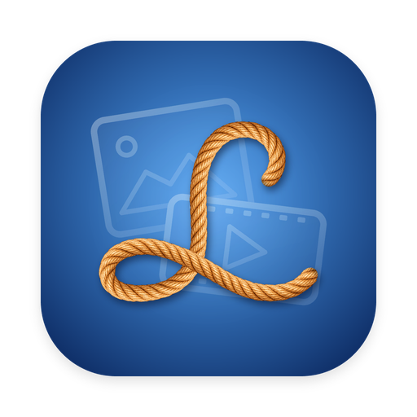

# Lasso

**Wrangle everything. Find anything.**

Lasso is a free Mac app for content creators and private users needing to manage large volumes of files. It gathers the raw photos and videos scattered across your folders, drives and cards, gives each one a clear, consistent name, and files it in one library you can filter and search. Everything happens on your Mac.

## What it does

- **Renames files to one pattern,** such as `2026-11-04_Paris_BROLL_001.mp4`: date, location, footage type and number. You can reorder the parts or swap in time, camera or a project name.
- **Suggests a footage type for every clip:** Talking head, A-roll, Voice over, Off-screen dialogue, B-roll or Scenery, using your Mac's built-in speech and face detection. Photos are labelled Photo.
- **Fills in the place** from a photo's or video's GPS location, or uses the location you type.
- **Copies, moves or renames in place,** your choice. Lasso never permanently deletes anything, and keeps a log of old and new names.
- **Transcribes clips with speech** into searchable caption files (.srt), on your Mac, with Whisper. Optional.
- **Groups people by face** so you can name them and search by name. Optional, off by default, and kept only on your Mac.
- **One library for everything,** with filters for footage type, place, people and media, and search across names, places, transcripts and people.
- **Knows your drives and cards,** even after they're renamed, and tells you which apps are blocking an eject.

## Requirements

- macOS 14 (Sonoma) or later
- An Apple silicon Mac (M1 or later) is recommended, especially for transcription
- About 0.5 GB of free space if you turn on transcription

## Download and install

1. Go to [Releases](../../releases) and download the latest **Lasso.zip**.
2. Double-click the zip to unzip it, then drag **Lasso** into your **Applications** folder.

## Opening Lasso the first time

Lasso is free and isn't signed with a paid Apple Developer account, so macOS asks you to confirm that you trust it the first time you open it. You only need to do this once.

1. Double-click **Lasso** in Applications. macOS shows a message that it couldn't verify Lasso. Click **Done** (or **OK**).
2. Open **System Settings › Privacy & Security**.
3. Scroll down to **Security**. You'll see "Lasso was blocked to protect your Mac." Click **Open Anyway**.
4. Confirm with **Open Anyway** again, and enter your Mac password or use Touch ID if asked.

Lasso now opens normally from then on.

## Folder and drive permissions

The first time Lasso reads your Desktop, Documents, Downloads or Movies folder, or a removable drive or card, macOS asks whether Lasso may access it. Click **Allow**: Lasso needs to read those folders to find and organize your photos and videos. You can change this later in **System Settings › Privacy & Security › Files and Folders**.

## Privacy

Lasso has no accounts, servers, analytics or ads, and its developer never receives your files or any information about them. It goes online only to download the transcription add-on once, if you turn transcription on, and to look up city names from GPS locations with Apple's location service (only the coordinates are sent). Read the full [Terms of Use and Privacy](TERMS.md).

## Building from source

1. Install Xcode 16 or later.
2. Clone this repository and open `Lasso.xcodeproj`.
3. Xcode downloads the two Swift packages (WhisperKit and ONNX Runtime) automatically.
4. Choose **My Mac** and press **⌘R**.

## About

Lasso was created up by an ideas person, not a coder, with help from Claude and the open-source projects below:

| Project | What it does in Lasso | Licence |
| --- | --- | --- |
| Apple Vision, SoundAnalysis and AVFoundation | Face, people and speech detection, built into macOS | Built in |
| WhisperKit by Argmax | On-device Whisper transcription of clips with speech | MIT |
| SFace (OpenCV Zoo) | On-device face matching for grouping people | Apache 2.0 |
| ONNX Runtime by Microsoft | Runs the face model on your Mac | MIT |
| [Opus Motion Library](https://github.com/GovinduSasanka) by Govindu Sasanka | The intro animation's motion, adapted from "Voxel burst swirl" | MIT |
| Fraunces, Inter, Sacramento and JetBrains Mono | Lasso's fonts | SIL Open Font License |

Full licence texts are in [THIRD_PARTY_NOTICES.md](THIRD_PARTY_NOTICES.md).

## Licence

Lasso is released under the [MIT License](LICENSE). © 2026 Devona Sharpe.
